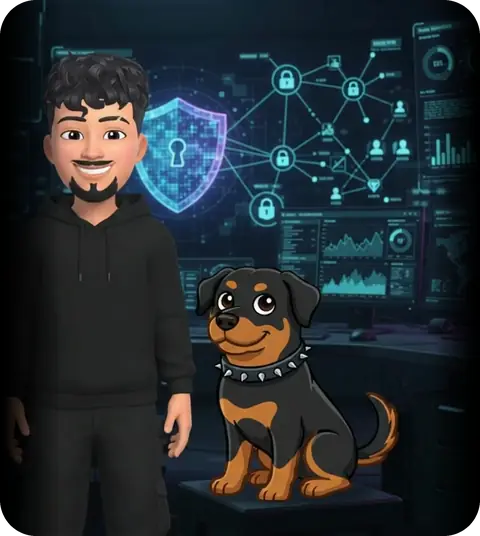

  

  <h1>👋 Hi, I'm Anveeksh Mahesh Rao</h1>

  <h3>🔐 Cybersecurity Researcher | Application Security | Usable Security</h3>

  

    🎓 MS in Cybersecurity | Northeastern University
     
    🛡️ Cybercrime Investigation | Digital Forensics | AI-Assisted Security
     
    🌍 Supported 30+ Organizations Across India, UAE & USA
     
    👨‍🏫 Cybersecurity Trainer & Guest Lecturer | 5,000+ Learners Reached
  

   

  

  

    🎬 Click the avatar or button above to watch my introduction with sound.
  

   

  

  

  

  

    Avatar animation created with generative AI.
  

 

<picture>
  <source
    media="(prefers-color-scheme: dark)"
    srcset="./assets/banner-dark.svg"
  />
  <source
    media="(prefers-color-scheme: light)"
    srcset="./assets/banner-light.svg"
  />
  
</picture>

---

## 👨‍💻 About Me

I am a **Cybersecurity Researcher and Security Engineer** pursuing my Master of Science in Cybersecurity at **Northeastern University, Khoury College of Computer Sciences**.

My work focuses on designing and evaluating security systems that are not only technically effective but also understandable, trustworthy, and usable.

I work at the intersection of:

- 🔐 **Application Security:** Secure software development, vulnerability research, and security testing.
- 🧠 **Usable Security:** Understanding how people interpret security warnings, risks, and protective actions.
- 🤖 **AI-Assisted Cybersecurity:** Evaluating machine learning and AI agents for cybersecurity applications.
- 🛡️ **Cybercrime Investigation:** Digital forensics, cybercrime analysis, and investigation methodologies.
- 🔎 **Privacy and Security Research:** Privacy-preserving technologies, online safety, and human-centered security.
- 🌐 **Secure Systems:** Firmware, IoT, wireless security, and vulnerability analysis.

### 🌍 Professional Impact

- **30+ organizations supported** across India, the UAE, and the United States.
- **5,000+ students and professionals reached** through cybersecurity training, workshops, and guest lectures.
- Experience in **cybercrime investigation and digital forensics**.
- Experience delivering cybersecurity awareness programs and technical workshops.
- Experience conducting security assessments, vulnerability analysis, and risk management activities.

**Research philosophy:**

> Security should not only protect systems. It should help people understand risks, make informed decisions, and protect themselves.

---

## 🔬 Current Research

### 🧠 Civic A.I. Lab | Northeastern University

**Graduate Student Researcher | 2026**

Researching computational approaches to understanding criminal recruitment and glorification content on social media platforms, particularly TikTok and YouTube.

My contributions include:

- Multilingual dataset development and terminology analysis.
- Research on coded language, regional slang, and online criminal communication.
- Machine learning classification using TF-IDF, Random Forest, XGBoost, BETO, and XLM-RoBERTa.
- Model evaluation, error analysis, and human annotation.
- Exploring how AI can support online safety research while accounting for contextual ambiguity and false positives.

**Research areas:** Multilingual NLP, AI for Social Good, Online Safety, Machine Learning, Human-Centered AI.

### 🔐 CACTi Lab | Northeastern University

**Research Assistant | 2025–Present**

Researching security challenges in firmware, IoT, and embedded systems.

Areas of work include:

- Firmware vulnerability analysis.
- Embedded systems security testing.
- Automated vulnerability discovery.
- Security testing methodologies.
- Analysis of software vulnerabilities and exploitation behavior in controlled environments.

**Research areas:** Firmware Security, IoT Security, Embedded Systems, Vulnerability Research.

### 🤖 AI-Assisted Cybersecurity Research

Exploring how artificial intelligence agents and large language models perform cybersecurity reasoning tasks.

Current research interests include:

- AI agents in cybersecurity challenges.
- Autonomous security reasoning.
- CTF-based evaluation environments.
- Agent failure classification.
- Recovery strategies and decision-making.
- Human-AI collaboration in cybersecurity.

My goal is to understand not only whether an AI security agent succeeds, but also **why it succeeds, where it fails, and how its behavior can be evaluated reliably**.

---

## 🚀 Selected Projects

### 🎣 [PhishGuard](https://github.com/anveeksh/PhishGuard)

**Machine Learning-Based Phishing Detection**

A machine learning system designed to identify potentially malicious URLs and support safer browsing decisions.

**Key features:**

- URL feature extraction.
- Rule-based and machine learning-assisted risk scoring.
- Random Forest and XGBoost classification.
- FastAPI backend integration.
- Research into robustness, generalization, and false-positive behavior.

**Technologies:** Python, scikit-learn, Random Forest, XGBoost, FastAPI.

### 🧠 CrimeSentinel

**Multilingual AI-Assisted Online Safety Research**

Research exploring the detection and analysis of criminal recruitment and glorification content across social media platforms.

**Key components:**

- Multilingual text processing.
- Terminology and slang analysis.
- Dataset development.
- Machine learning classification.
- Human-centered evaluation.
- Error analysis and research validation.

**Technologies:** Python, TF-IDF, Random Forest, XGBoost, BETO, XLM-RoBERTa.

### 🔗 Security-Enhanced QR Codes (SEQR)

**Usable Security and Risk Communication Research**

Exploring how people interpret security information when scanning QR codes.

Research questions include:

- How should QR-code security warnings communicate uncertainty?
- How do users interpret potentially risky destinations?
- What information helps users make safer decisions?
- How should security systems communicate risks without creating unnecessary fear?

**Research areas:** Usable Security, Human-Computer Interaction, Security Warnings, Risk Communication.

---

## 👨‍🏫 Teaching, Training & Leadership

### 🌍 Cybersecurity Training and Professional Experience

I have supported **30+ organizations across India, the UAE, and the United States** through cybersecurity-related work.

My experience includes:

- Application security and vulnerability assessments.
- Cybersecurity consulting and risk management.
- Digital forensics and cybercrime investigation.
- Security awareness and technical training.
- Secure software development practices.
- Information security governance and compliance.

### 🎓 Cybersecurity Trainer & Guest Lecturer

I have reached **5,000+ students and professionals** through cybersecurity education, workshops, training programs, and guest lectures.

Topics covered include:

- Ethical hacking and cybersecurity fundamentals.
- Application security.
- Digital forensics and cybercrime investigation.
- IoT and embedded systems security.
- Cybersecurity awareness.
- Privacy and online safety.
- Career development in cybersecurity.

I have delivered guest lectures and workshops at educational institutions, including:

- Alva's Institute of Engineering and Technology.
- Srinivas University.
- Other universities, colleges, and organizations across India and the UAE.

### 💼 Entrepreneurship & Leadership

**Co-Founder | NiyantraX (formerly Cyber Tech Associates)**

Experience building and delivering cybersecurity consulting, governance, risk, and compliance services.

Areas of work include:

- ISO/IEC 27001.
- NIST Cybersecurity Framework.
- SOC 2.
- GDPR and HIPAA.
- Security risk assessments.
- Cybersecurity consulting.
- Security engineering and incident response.

---

## 🛠️ Technical Skills

<b>💻 View Technical Skills</b>

 

| Area | Skills |
|---|---|
| Programming | Python, Bash, SQL, JavaScript, HTML, FastAPI, REST APIs, Git |
| Machine Learning | scikit-learn, Transformers, TF-IDF, Random Forest, XGBoost |
| Multilingual NLP | BETO, XLM-RoBERTa, Text Classification |
| Application Security | Burp Suite, Secure Coding, Vulnerability Assessment, API Security |
| Security Operations | SIEM, Threat Intelligence, Incident Response, Security Monitoring |
| Digital Forensics | Autopsy, Digital Evidence Analysis, Incident Investigation |
| Network Security | Wireshark, Nmap, Network Analysis |
| Systems Security | Firmware Security, IoT Security, Wireless Security |
| Governance & Risk | NIST CSF, ISO 27001, GDPR, HIPAA, SOC 2 |
| Research | Experimental Design, Dataset Development, Literature Review, Model Evaluation, LaTeX |

---

## 🎓 Education

<b>📚 View Education and Certifications</b>

 

### Northeastern University | Boston, Massachusetts

**Master of Science in Cybersecurity**

Khoury College of Computer Sciences

2025–2027

### Srinivas University | India

**Bachelor of Technology in Cyber Security and Cyber Forensics**

2020–2024

### Certifications

- CompTIA Security+
- Cisco Certified Support Technician (Cybersecurity)
- Google Cybersecurity Professional Certificate
- ISO/IEC 27001:2022
- Microsoft Security Copilot
- IT Specialist (Cybersecurity)
- IT Specialist (Python)
- Cisco Enterprise Networking, Security, and Automation

---

## 🎯 Research Interests

My current research interests include:

- Human-Centered and Usable Security.
- Application Security and Secure Software Engineering.
- AI-Assisted Cybersecurity.
- Phishing and Social Engineering.
- Security Warnings and Risk Communication.
- Privacy and Privacy-Enhancing Technologies.
- AI Agent Security and Evaluation.
- Cybercrime Analysis and Digital Forensics.
- Firmware, IoT, and Embedded Systems Security.

---

## 🤝 Collaboration & Opportunities

I am interested in collaborating on:

- Cybersecurity research projects.
- Usable security and privacy research.
- AI-assisted security tools.
- Application security research.
- Security education and awareness.
- Human-centered cybersecurity.
- Secure software engineering.

**Open to:** Research internships, cybersecurity research collaborations, application security roles, security engineering opportunities, and GRC-related positions.

---

## 📫 Connect With Me

  

  

  

---

### 🔐 Research. Investigate. Build. Secure.

*Building security that is not only technically sound, but understandable, trustworthy, and usable by the people it is meant to protect.*

**Thank you for visiting my GitHub profile! 🚀**

