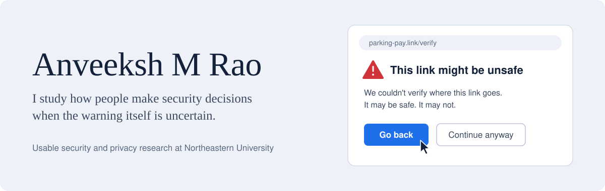

  

<h1 align="center">Anveeksh Mahesh Rao</h1>

  <b>Cybersecurity researcher in usable security and privacy</b> 
  MS Cybersecurity, Khoury College of Computer Sciences, Northeastern University

  
  
  
  <!-- TODO: add your YouTube channel URL, then uncomment:
  
  -->

The avatar animation is AI-generated.

 

<picture>
  <source media="(prefers-color-scheme: dark)" srcset="./assets/banner-dark.svg">
  <source media="(prefers-color-scheme: light)" srcset="./assets/banner-light.svg">
  
</picture>

## About

I study how people interact with security systems, and how to design technology that communicates risk, uncertainty, privacy implications, and protective actions in a way people can act on. My work sits between human-centered security and applied machine learning: phishing, social engineering, security warnings, and AI-assisted security.

**Core interests:** human-centered and usable security, phishing and social engineering, security warnings and risk communication, privacy and PETs. 
**Also working on:** AI security and LLM agents, multilingual NLP for online safety, firmware and IoT security.

## Current research

### Civic A.I. Lab, Northeastern University
Graduate Student Researcher, 2026–present

Computational methods for detecting criminal recruitment and glorification content on TikTok and YouTube. I work on the multilingual dataset, terminology analysis, classification (TF-IDF baselines, BETO, XLM-RoBERTa), and model evaluation and error analysis.

### CACTi Lab, Northeastern University
Research Assistant, 2025–present

Firmware, IoT, and embedded systems security, with a focus on automated vulnerability discovery and security testing.

### AI-assisted cybersecurity
Testing what AI agents and large language models can and can't do in security reasoning, including CTF-style challenges. Interested in how to evaluate AI security capabilities and how humans and AI should work together on security tasks.

## Selected projects

**CrimeSentinel** 
Multilingual detection of criminal recruitment and glorification content on TikTok and YouTube. Dataset development, terminology analysis, classification, and evaluation. 
Python, TF-IDF, Random Forest, XGBoost, BETO, XLM-RoBERTa

**[PhishGuard](https://github.com/anveeksh/PhishGuard)** 
Machine learning system that flags phishing and malicious URLs, combining URL feature extraction with rule-based and ML-assisted risk scoring. Current work focuses on generalization and robustness. 
Python, scikit-learn, Random Forest, XGBoost, FastAPI

**Security-Enhanced QR Codes (SEQR)** 
How do people interpret and respond to security information when they scan a QR code, especially when the system can't tell if the destination is safe? Usable security, warnings, and decision-making under uncertainty.

## Teaching and leadership

**Founder, Cyber Tech Associates** (2020–present). A cybersecurity education and consulting initiative: technical training, awareness programs, digital forensics workshops, and student mentoring.

I've guest lectured on IoT security and digital forensics at Alva's Institute of Engineering and Technology and Srinivas University, and spoken at 10+ universities and 30+ organizations across India and the UAE. 5,000+ students and professionals trained so far.

<b>Skills</b>

 

| Area | Skills |
|---|---|
| Programming | Python, Bash, SQL, JavaScript, HTML, FastAPI, REST APIs, Git |
| Machine learning and NLP | scikit-learn, Transformers, TF-IDF, Random Forest, XGBoost, BETO, XLM-RoBERTa, text classification |
| Security tools | Wireshark, Burp Suite, Nmap, Splunk, Autopsy, GPG |
| Security practice | SIEM, threat intelligence, incident response, vulnerability analysis, digital forensics |
| Systems security | Firmware, IoT, network, and wireless security |
| Governance, risk, and privacy | NIST, ISO 27001, GDPR, HIPAA, SOC 2, risk assessment |
| Research | Experimental design, dataset development, literature review, model evaluation, research writing, LaTeX |

<b>Education and certifications</b>

 

**Northeastern University**, Boston 
MS Cybersecurity, Khoury College of Computer Sciences, 2025–2027

**Srinivas University**, India 
B.Tech, Cyber Security and Cyber Forensics, 2020–2024

**Certifications:** CompTIA Security+, Cisco Certified Support Technician (Cybersecurity), Google Cybersecurity Professional Certificate, ISO/IEC 27001:2022, Microsoft Security Copilot, IT Specialist (Cybersecurity), IT Specialist (Python), Cisco Enterprise Networking, Security, and Automation

---

**Open to** research internships and roles in usable security, privacy, AI security, security engineering, and GRC.

<i>Building security that is not only technically sound, but understandable, trustworthy, and usable by the people it is meant to protect.</i>
