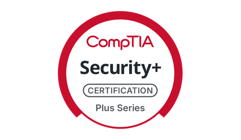
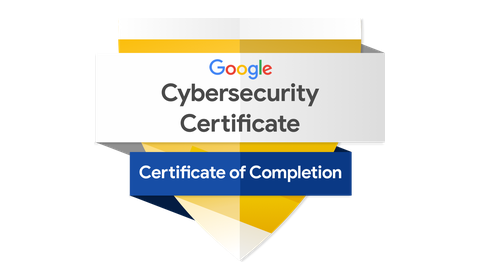
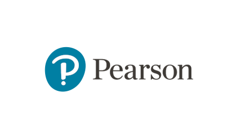

<!-- INTRO VIDEO: on github.com, edit this file and replace the VIDEO_URL line below by dragging my_intro_github.mp4 onto it. -->

<!-- VIDEO_URL -->

AI-generated intro video. Turn your sound on.

  

  <h1>👋 Hi, I'm Anveeksh Mahesh Rao</h1>

  <h3>🔐 Cybersecurity Researcher | Application Security | Usable Security</h3>

 

---

## 👨‍💻 About Me

## Research

<table>
<tr>
<td width="33%" valign="top">
<b>Civic A.I. Lab</b> 
Northeastern University Graduate Student Researcher, 2026–present
  
Computational methods for detecting criminal recruitment and glorification content on TikTok and YouTube. Multilingual dataset, terminology analysis, classification (TF-IDF baselines, BETO, XLM-RoBERTa), and error analysis.
</td>
<td width="33%" valign="top">
<b>CACTi Lab</b> 
Northeastern University Research Assistant, 2025–present
  
Firmware, IoT, and embedded systems security, with a focus on automated vulnerability discovery and security testing.
</td>
<td width="33%" valign="top">
<b>AI-assisted cybersecurity</b> 
Northeastern University Research Apprenticeship, 2026–present
  
What AI agents and large language models can and can't do in security reasoning, including CTF-style challenges, and how humans and AI should work together on security tasks.
</td>
</tr>
</table>

## Projects

<table>
<tr>
<td width="33%" valign="top">
<b>CrimeSentinel</b> 
Online safety, multilingual NLP
  
Detecting criminal recruitment and glorification content on TikTok and YouTube. Dataset development, terminology analysis, classification, and evaluation.
  
Python, TF-IDF, Random Forest, XGBoost, BETO, XLM-RoBERTa
</td>
<td width="33%" valign="top">
<b><a href="https://github.com/anveeksh/PhishGuard">PhishGuard</a></b> 
Phishing detection
  
Flags phishing and malicious URLs by combining URL feature extraction with rule-based and ML-assisted risk scoring. Current work: generalization and robustness.
  
Python, scikit-learn, Random Forest, XGBoost, FastAPI
</td>
<td width="33%" valign="top">
<b>SEQR</b> 
Usable security, risk communication
  
How people interpret and respond to security information when they scan a QR code, especially when the system can't tell if the destination is safe.
</td>
</tr>
</table>

## Certifications

<!-- To make each badge verifiable, wrap its  in a link to your Credly or issuer page:
      -->

<table>
<tr>
<td width="25%" align="center" valign="top">
 
<b>CompTIA Security+</b> 
SY0-701
</td>
<td width="25%" align="center" valign="top">
 
<b>Google Cybersecurity</b> 
Professional Certificate
</td>
<td width="25%" align="center" valign="top">
 
<b>Cisco CCST</b> 
Cybersecurity
</td>
<td width="25%" align="center" valign="top">
 
<b>IT Specialist</b> 
Cybersecurity and Python
</td>
</tr>
</table>

Also: ISO/IEC 27001:2022, Microsoft Security Copilot, and Cisco Enterprise Networking, Security, and Automation (course).

**Graduate Student Researcher | 2026**

Researching computational approaches to understanding criminal recruitment and glorification content on social media platforms, particularly TikTok and YouTube.

My contributions include:

- Multilingual dataset development and terminology analysis.
- Research on coded language, regional slang, and online criminal communication.
- Machine learning classification using TF-IDF, Random Forest, XGBoost, BETO, and XLM-RoBERTa.
- Model evaluation, error analysis, and human annotation.
- Exploring how AI can support online safety research while accounting for contextual ambiguity and false positives.

**Research areas:** Multilingual NLP, AI for Social Good, Online Safety, Machine Learning, Human-Centered AI.

### 🔐 CACTi Lab | Northeastern University

**Research Assistant | 2025–Present**

Researching security challenges in firmware, IoT, and embedded systems.

Areas of work include:

- Firmware vulnerability analysis.
- Embedded systems security testing.
- Automated vulnerability discovery.
- Security testing methodologies.
- Analysis of software vulnerabilities and exploitation behavior in controlled environments.

**Research areas:** Firmware Security, IoT Security, Embedded Systems, Vulnerability Research.

### 🤖 AI-Assisted Cybersecurity Research

Exploring how artificial intelligence agents and large language models perform cybersecurity reasoning tasks.

Current research interests include:

- AI agents in cybersecurity challenges.
- Autonomous security reasoning.
- CTF-based evaluation environments.
- Agent failure classification.
- Recovery strategies and decision-making.
- Human-AI collaboration in cybersecurity.

My goal is to understand not only whether an AI security agent succeeds, but also **why it succeeds, where it fails, and how its behavior can be evaluated reliably**.

---

## 🚀 Selected Projects

### 🎣 [PhishGuard](https://github.com/anveeksh/PhishGuard)

**Machine Learning-Based Phishing Detection**

A machine learning system designed to identify potentially malicious URLs and support safer browsing decisions.

**Key features:**

- URL feature extraction.
- Rule-based and machine learning-assisted risk scoring.
- Random Forest and XGBoost classification.
- FastAPI backend integration.
- Research into robustness, generalization, and false-positive behavior.

**Technologies:** Python, scikit-learn, Random Forest, XGBoost, FastAPI.

### 🧠 CrimeSentinel

**Multilingual AI-Assisted Online Safety Research**

Research exploring the detection and analysis of criminal recruitment and glorification content across social media platforms.

**Key components:**

- Multilingual text processing.
- Terminology and slang analysis.
- Dataset development.
- Machine learning classification.
- Human-centered evaluation.
- Error analysis and research validation.

**Technologies:** Python, TF-IDF, Random Forest, XGBoost, BETO, XLM-RoBERTa.

### 🔗 Security-Enhanced QR Codes (SEQR)

**Usable Security and Risk Communication Research**

Exploring how people interpret security information when scanning QR codes.

Research questions include:

- How should QR-code security warnings communicate uncertainty?
- How do users interpret potentially risky destinations?
- What information helps users make safer decisions?
- How should security systems communicate risks without creating unnecessary fear?

**Research areas:** Usable Security, Human-Computer Interaction, Security Warnings, Risk Communication.

---

## 👨‍🏫 Teaching, Training & Leadership

### 🌍 Cybersecurity Training and Professional Experience

I have supported **30+ organizations across India, the UAE, and the United States** through cybersecurity-related work.

My experience includes:

- Application security and vulnerability assessments.
- Cybersecurity consulting and risk management.
- Digital forensics and cybercrime investigation.
- Security awareness and technical training.
- Secure software development practices.
- Information security governance and compliance.

### 🎓 Cybersecurity Trainer & Guest Lecturer

I have reached **5,000+ students and professionals** through cybersecurity education, workshops, training programs, and guest lectures.

Topics covered include:

- Ethical hacking and cybersecurity fundamentals.
- Application security.
- Digital forensics and cybercrime investigation.
- IoT and embedded systems security.
- Cybersecurity awareness.
- Privacy and online safety.
- Career development in cybersecurity.

I have delivered guest lectures and workshops at educational institutions, including:

- Alva's Institute of Engineering and Technology.
- Srinivas University.
- Other universities, colleges, and organizations across India and the UAE.

### 💼 Entrepreneurship & Leadership

**Co-Founder | NiyantraX (formerly Cyber Tech Associates)**

Experience building and delivering cybersecurity consulting, governance, risk, and compliance services.

Areas of work include:

- ISO/IEC 27001.
- NIST Cybersecurity Framework.
- SOC 2.
- GDPR and HIPAA.
- Security risk assessments.
- Cybersecurity consulting.
- Security engineering and incident response.

---

## 🛠️ Technical Skills

<b>💻 View Technical Skills</b>

 

| Area | Skills |
|---|---|
| Programming | Python, Bash, SQL, JavaScript, HTML, FastAPI, REST APIs, Git |
| Machine learning and NLP | scikit-learn, Transformers, TF-IDF, Random Forest, XGBoost, BETO, XLM-RoBERTa, text classification |
| Security tools | Wireshark, Burp Suite, Nmap, Splunk, Autopsy, GPG |
| Security practice | SIEM, threat intelligence, incident response, vulnerability analysis, digital forensics |
| Systems security | Firmware, IoT, network, and wireless security |
| Governance, risk, and privacy | NIST, ISO 27001, GDPR, HIPAA, SOC 2, risk assessment |
| Research | Experimental design, dataset development, literature review, model evaluation, research writing, LaTeX |

<b>Education</b>

 

**Northeastern University**, Boston 
MS Cybersecurity, Khoury College of Computer Sciences, 2025–2027

**Srinivas University**, India 
B.Tech, Cyber Security and Cyber Forensics, 2020–2024

---

## 🎓 Education

<b>📚 View Education and Certifications</b>

 

### Northeastern University | Boston, Massachusetts

**Master of Science in Cybersecurity**

Khoury College of Computer Sciences

2025–2027

### Srinivas University | India

**Bachelor of Technology in Cyber Security and Cyber Forensics**

2020–2024

### Certifications

- CompTIA Security+
- Cisco Certified Support Technician (Cybersecurity)
- Google Cybersecurity Professional Certificate
- ISO/IEC 27001:2022
- Microsoft Security Copilot
- IT Specialist (Cybersecurity)
- IT Specialist (Python)
- Cisco Enterprise Networking, Security, and Automation

---

## 🎯 Research Interests

My current research interests include:

- Human-Centered and Usable Security.
- Application Security and Secure Software Engineering.
- AI-Assisted Cybersecurity.
- Phishing and Social Engineering.
- Security Warnings and Risk Communication.
- Privacy and Privacy-Enhancing Technologies.
- AI Agent Security and Evaluation.
- Cybercrime Analysis and Digital Forensics.
- Firmware, IoT, and Embedded Systems Security.

---

## 🤝 Collaboration & Opportunities

I am interested in collaborating on:

- Cybersecurity research projects.
- Usable security and privacy research.
- AI-assisted security tools.
- Application security research.
- Security education and awareness.
- Human-centered cybersecurity.
- Secure software engineering.

**Open to:** Research internships, cybersecurity research collaborations, application security roles, security engineering opportunities, and GRC-related positions.

---

## 📫 Connect With Me

  

  

  

---

### 🔐 Research. Investigate. Build. Secure.

*Building security that is not only technically sound, but understandable, trustworthy, and usable by the people it is meant to protect.*

**Thank you for visiting my GitHub profile! 🚀**

