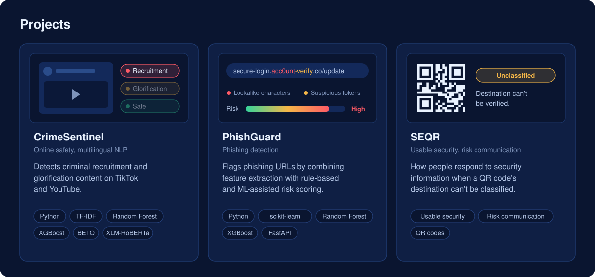

<!-- INTRO VIDEO -->

https://github.com/user-attachments/assets/98d5768b-395f-47c6-b5a4-bc2bb436abaf

AI-generated intro video. Turn your sound on.

<h1 align="center">Anveeksh Mahesh Rao</h1>

  <b>Cybersecurity researcher in usable security and privacy</b> 
  MS Cybersecurity, Khoury College of Computer Sciences, Northeastern University

  
  
  
  <!-- TODO: add your YouTube channel URL, then uncomment:
  
  -->

 

## About

I study how people interact with security systems, and how to design technology that communicates risk, uncertainty, privacy implications, and protective actions in a way people can act on. My work sits between human-centered security and applied machine learning: phishing, social engineering, security warnings, and AI-assisted security.

Code: <a href="https://github.com/anveeksh/PhishGuard">PhishGuard on GitHub</a>

<!-- To make badges verifiable, add links here once you have them, for example:

Verify: <a href="CREDLY_URL">Security+</a>, <a href="CREDLY_URL">Google</a>, <a href="CREDLY_URL">CCST</a>, <a href="CREDLY_URL">IT Specialist</a>

-->

<b>Skills</b>

 

| Area | Skills |
|---|---|
| Programming | Python, Bash, SQL, JavaScript, HTML, FastAPI, REST APIs, Git |
| Machine learning and NLP | scikit-learn, Transformers, TF-IDF, Random Forest, XGBoost, BETO, XLM-RoBERTa, text classification |
| Security tools | Wireshark, Burp Suite, Nmap, Splunk, Autopsy, GPG |
| Security practice | SIEM, threat intelligence, incident response, vulnerability analysis, digital forensics |
| Systems security | Firmware, IoT, network, and wireless security |
| Governance, risk, and privacy | NIST, ISO 27001, GDPR, HIPAA, SOC 2, risk assessment |
| Research | Experimental design, dataset development, literature review, model evaluation, research writing, LaTeX |

<b>Education</b>

 

**Northeastern University**, Boston 
MS Cybersecurity, Khoury College of Computer Sciences, 2025–2027

**Srinivas University**, India 
B.Tech, Cyber Security and Cyber Forensics, 2020–2024

---

**Open to** research internships and roles in usable security, privacy, AI security, security engineering, and GRC.

<i>Building security that is not only technically sound, but understandable, trustworthy, and usable by the people it is meant to protect.</i>
