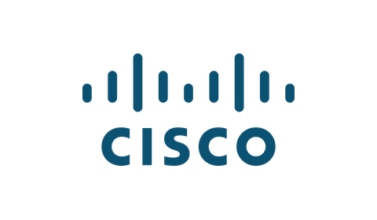

<!-- INTRO VIDEO: on github.com, edit this file and replace the VIDEO_URL line below by dragging my_intro_github.mp4 onto it. -->

https://github.com/user-attachments/assets/98d5768b-395f-47c6-b5a4-bc2bb436abaf

AI-generated intro video. Turn your sound on.

<h1 align="center">Anveeksh Mahesh Rao</h1>

  <b>Cybersecurity researcher in usable security and privacy</b> 
  MS Cybersecurity, Khoury College of Computer Sciences, Northeastern University

  
  
  
  <!-- TODO: add your YouTube channel URL, then uncomment:
  
  -->

 

## About

I study how people interact with security systems, and how to design technology that communicates risk, uncertainty, privacy implications, and protective actions in a way people can act on. My work sits between human-centered security and applied machine learning: phishing, social engineering, security warnings, and AI-assisted security.

## Research

<table>
<tr>
<td width="33%" valign="top">
<b>Civic A.I. Lab</b> 
Northeastern University Graduate Student Researcher, 2026–present
  
Computational methods for detecting criminal recruitment and glorification content on TikTok and YouTube. Multilingual dataset, terminology analysis, classification (TF-IDF baselines, BETO, XLM-RoBERTa), and error analysis.
</td>
<td width="33%" valign="top">
<b>CACTi Lab</b> 
Northeastern University Research Assistant, 2025–present
  
Firmware, IoT, and embedded systems security, with a focus on automated vulnerability discovery and security testing.
</td>
<td width="33%" valign="top">
<b>AI-assisted cybersecurity</b> 
Northeastern University Research Apprenticeship, 2026–present
  
What AI agents and large language models can and can't do in security reasoning, including CTF-style challenges, and how humans and AI should work together on security tasks.
</td>
</tr>
</table>

## Projects

<table>
<tr>
<td width="33%" valign="top">
<b>CrimeSentinel</b> 
Online safety, multilingual NLP
  
Detecting criminal recruitment and glorification content on TikTok and YouTube. Dataset development, terminology analysis, classification, and evaluation.
  
Python, TF-IDF, Random Forest, XGBoost, BETO, XLM-RoBERTa
</td>
<td width="33%" valign="top">
<b><a href="https://github.com/anveeksh/PhishGuard">PhishGuard</a></b> 
Phishing detection
  
Flags phishing and malicious URLs by combining URL feature extraction with rule-based and ML-assisted risk scoring. Current work: generalization and robustness.
  
Python, scikit-learn, Random Forest, XGBoost, FastAPI
</td>
<td width="33%" valign="top">
<b>SEQR</b> 
Usable security, risk communication
  
How people interpret and respond to security information when they scan a QR code, especially when the system can't tell if the destination is safe.
</td>
</tr>
</table>

## Certifications

<!-- To make each badge verifiable, wrap its  in a link to your Credly or issuer page:
      -->

<table>
<tr>
<td width="25%" align="center" valign="top">
 
<b>CompTIA Security+</b> 
SY0-701
</td>
<td width="25%" align="center" valign="top">
 
<b>Google Cybersecurity</b> 
Professional Certificate
</td>
<td width="25%" align="center" valign="top">
 
<b>Cisco CCST</b> 
Cybersecurity
</td>
<td width="25%" align="center" valign="top">
 
<b>IT Specialist</b> 
Cybersecurity and Python
</td>
</tr>
</table>

Also: ISO/IEC 27001:2022, Microsoft Security Copilot, and Cisco Enterprise Networking, Security, and Automation (course).

## Teaching and leadership

**Founder, Cyber Tech Associates** (2020–present). A cybersecurity education and consulting initiative: technical training, awareness programs, digital forensics workshops, and student mentoring.

I've guest lectured on IoT security and digital forensics at Alva's Institute of Engineering and Technology and Srinivas University, and spoken at 10+ universities and 30+ organizations across India and the UAE. 5,000+ students and professionals trained so far.

<b>Skills</b>

 

| Area | Skills |
|---|---|
| Programming | Python, Bash, SQL, JavaScript, HTML, FastAPI, REST APIs, Git |
| Machine learning and NLP | scikit-learn, Transformers, TF-IDF, Random Forest, XGBoost, BETO, XLM-RoBERTa, text classification |
| Security tools | Wireshark, Burp Suite, Nmap, Splunk, Autopsy, GPG |
| Security practice | SIEM, threat intelligence, incident response, vulnerability analysis, digital forensics |
| Systems security | Firmware, IoT, network, and wireless security |
| Governance, risk, and privacy | NIST, ISO 27001, GDPR, HIPAA, SOC 2, risk assessment |
| Research | Experimental design, dataset development, literature review, model evaluation, research writing, LaTeX |

<b>Education</b>

 

**Northeastern University**, Boston 
MS Cybersecurity, Khoury College of Computer Sciences, 2025–2027

**Srinivas University**, India 
B.Tech, Cyber Security and Cyber Forensics, 2020–2024

---

**Open to** research internships and roles in usable security, privacy, AI security, security engineering, and GRC.

<i>Building security that is not only technically sound, but understandable, trustworthy, and usable by the people it is meant to protect.</i>
